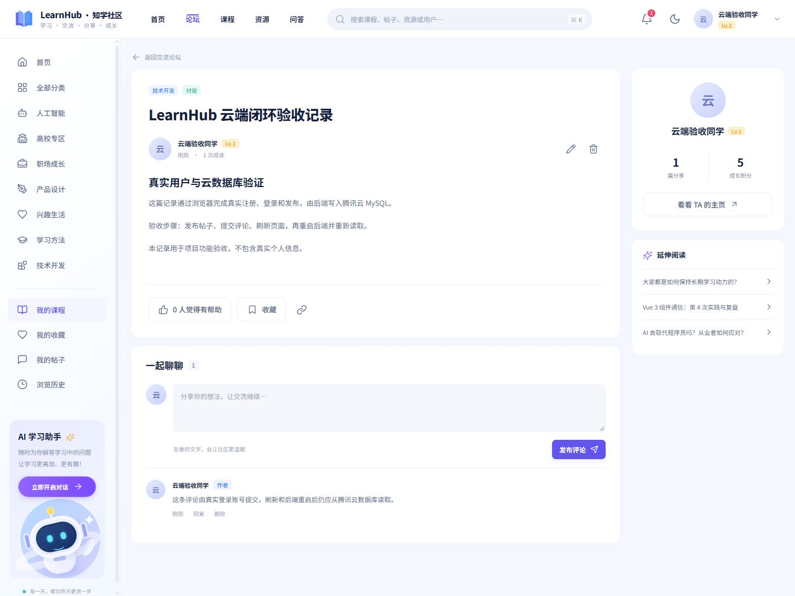
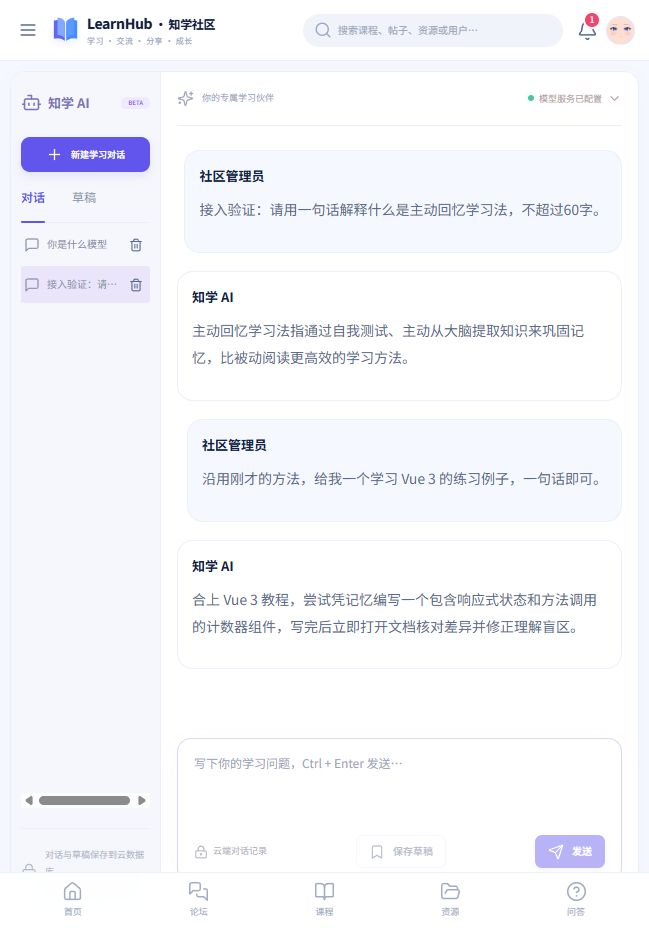
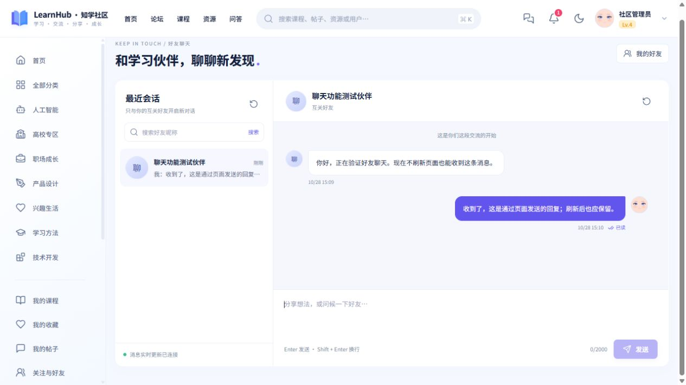

# LearnHub · 知学社区

一个集知识交流、课程学习、资源分享和 AI 辅助学习于一体的全栈社区项目。基于 **Vue 3 + TypeScript + Node.js + MySQL** 构建，面向学习者、教师和社区管理员，提供从内容发布、互动讨论到学习记录与社区管理的完整业务流程。

适合用于学习社区搭建、全栈开发实践和毕业设计参考。前后端源码、数据库迁移、演示数据初始化脚本、测试与部署配置均包含在仓库中。

[功能介绍](#功能介绍) · [快速开始](#快速开始) · [AI 配置](#ai-配置) · [项目结构](#项目结构) · [部署与测试](#部署与测试) · [项目文档](#项目文档)

## 项目预览


<details>
<summary>查看更多界面</summary>

**社区讨论**



**课程学习**


**AI 学习助手**



**好友聊天**



**移动端**


</details>

## 功能介绍

| 模块 | 主要功能 |
| --- | --- |
| 用户与权限 | 注册、登录、退出、个人资料、头像与密码修改；普通用户、教师、管理员角色及服务端权限校验 |
| 社区论坛 | 分类浏览、发帖与编辑、审核、评论与回复、点赞、收藏、搜索、分页与排序 |
| 教育问答 | 提问、回答、评论、最佳答案采纳、积分悬赏与结算 |
| 课程学习 | 图文课程、章节管理、报名、学习进度、继续学习与课程评价 |
| 学习资源 | 文件上传、审核、受保护下载、收藏与下载记录 |
| 社交互动 | 关注、粉丝、互关好友、关注动态、好友文字私聊、未读与已读状态 |
| 用户成长 | 签到、积分流水、等级、徽章与排行榜 |
| 消息与个人中心 | 通知、社区公告、个人内容、收藏、学习记录、浏览历史与数据导出 |
| AI 学习助手 | 流式回答、连续对话、历史记录、停止生成、失败重试与学习草稿 |
| 社区管理 | 用户、帖子审核、分类、课程、资源、问答、公告、积分规则与操作日志 |

论坛、课程、问答和资源等业务数据由后端读写 MySQL；浏览器仅保留主题偏好和未发布的编辑草稿。搜索与列表分页在服务端执行，积分奖励和悬赏结算通过事务及唯一事件约束防止重复发放。

界面支持响应式布局、深色模式和首页自动轮播，并提供图片尺寸适配、延迟加载与生产静态缓存配置。

## 技术栈

| 层次 | 技术 |
| --- | --- |
| 前端 | Vue 3、TypeScript、Vite、Vue Router、Pinia |
| 界面与内容 | Lucide、ECharts、Markdown、DOMPurify |
| 后端 | Node.js、Express 5、mysql2、Zod |
| 数据库 | MySQL 8、SQL 迁移、外键与唯一约束 |
| 身份与安全 | Cookie 会话、scrypt 密码哈希、CSRF 校验、请求限流、文件类型校验 |
| AI 接口 | 服务端兼容 OpenAI Chat Completions 的流式接口 |
| 测试与构建 | Vitest、Node.js Test Runner、vue-tsc、Vite |
| 部署 | Node.js 生产服务、Caddy / Nginx 反向代理、systemd |

具体依赖版本以 [package.json](package.json) 和 [package-lock.json](package-lock.json) 为准。

## 快速开始

### 1. 准备运行环境

- Node.js **24 或更高版本**及 npm。
- MySQL **8**，准备独立数据库和项目专用账号。
- Git，用于获取源码。
- Windows 下，私有配置和初始化账号使用 DPAPI 保存，需要可运行的 Python 3；通过 `DB_PYTHON` 指定本机 Python 可执行文件。Linux 下私有初始化文件写入 `.local/`，应限制目录访问权限。

### 2. 获取源码与安装依赖

```bash
git clone https://github.com/Elysia-UI/learnhub.git
cd learnhub
npm ci
```

仓库访问权限以托管平台设置为准。也可以下载源码压缩包，解压后在项目根目录执行安装命令。

### 3. 创建数据库与配置环境变量

由数据库管理员执行 [server/provision.sql](server/provision.sql) 创建 `learnhub` 数据库，并按脚本说明建立专用账号、授权。该脚本不包含实际连接密码。

将 `.env.example` 复制为 `.env`，填写自己的配置：

```dotenv
DB_HOST=127.0.0.1
DB_PORT=3306
DB_NAME=learnhub
DB_USER=learnhub_app
DB_PASSWORD=replace-with-your-database-password
DB_SSL=false
API_HOST=127.0.0.1
API_PORT=3001
APP_ORIGINS=http://127.0.0.1:5173,http://127.0.0.1:3001,http://127.0.0.1:4173
```

以上为本机开发示例。生产环境连接远程数据库时需启用 TLS，并通过 `DB_SSL_CA` 配置可信 CA；详细配置见 [部署说明](docs/deployment.md)。数据库密码和 AI 密钥只配置在服务端，不使用 `VITE_` 前缀，不提交 `.env`。

### 4. 初始化与启动

```bash
npm run db:init
npm start
```

初始化会执行数据库迁移、演示数据写入和徽章补录。重复执行会根据迁移版本和初始化标记跳过已处理内容；升级已有环境可单独运行 `npm run db:migrate`。

启动后访问：

- [社区首页](http://127.0.0.1:5173/)
- [管理后台](http://127.0.0.1:5173/admin)
- [好友聊天](http://127.0.0.1:5173/messages)
- [AI 学习助手](http://127.0.0.1:5173/ai)
- [服务健康检查](http://127.0.0.1:5173/api/health)

Windows 也可以双击 `启动项目.cmd`；默认同时启动前后端并打开浏览器。按 `Ctrl+C` 停止服务。

### 5. 获取初始化账号

首次初始化会生成管理员、教师和普通用户的虚拟账号，密码随机生成。也可在首次初始化前通过服务端 `ADMIN_EMAIL`、`ADMIN_PASSWORD` 指定管理员凭据。

```bash
npm run accounts:show
npm run accounts:show -- teacher
npm run accounts:show -- u1
```

这些命令仅用于部署者在本机查看初始化凭据，请勿公开命令输出。已有账号不会因再次修改初始化环境变量而重置密码。

## AI 配置

AI 为可选服务。在服务端 `.env` 中配置兼容的模型服务：

```dotenv
AI_BASE_URL=https://your-provider.example/v1
AI_API_KEY=replace-with-your-provider-key
AI_MODEL=your-model-id
```

配置后重启后端。接口支持流式对话、历史读取和调用限制；模型名称与接口地址以所选服务商为准。未配置时，页面显示配置提示，不会生成模拟回答。密钥不会传递给前端。AI 使用需要部署者自行提供模型服务和调用额度，演示站是否开放此功能取决于其运行配置。

## 演示数据

项目提供可重复执行的初始化脚本，基础数据包括：

| 类型 | 基础规模 |
| --- | ---: |
| 虚拟用户 | 30 |
| 论坛帖子 / 评论 | 100 / 300 |
| 图文课程 / 章节 | 20 / 80 |
| 学习资源文件 | 50 |
| 问题 / 回答 | 30 / 60 |

同时初始化关联的点赞、收藏、报名、进度、积分、通知和公告。内容扩充脚本及实际操作可能使数量增加，页面统计从数据库查询，不以这些示例数字作为运营统计。

初始资源包含实际 Markdown / CSV 文件。示例人物、头像昵称和社区内容仅用于演示，课程以图文章节为主，不包含视频点播平台。

## 项目结构

```text
learnhub/
├── src/                    前端页面、组件、路由、状态与 API 请求
├── public/                 公共图片、图标与静态素材
├── server/
│   ├── routes/             业务接口
│   ├── services/           积分、通知、权限与业务服务
│   ├── migrations/         数据库版本迁移
│   ├── demo/               演示内容
│   └── tests/              后端与集成测试
├── scripts/                启动、初始化、迁移、备份与检查工具
├── tests/                  前端测试
├── deploy/                 生产部署配置模板
├── docs/                   架构、数据库、接口与使用文档
├── .env.example            环境变量示例
└── package.json            依赖和运行命令
```

运行时私有配置保存在 `.local/`，上传与演示文件保存在 `.storage/`；这些目录和 `.env` 均不进入 Git。备份时需同时保存数据库与私有文件目录，不能仅备份源码。

## 部署与测试

开发时可使用 `npm run dev` 和 `npm run dev:api` 分别启动前后端。生产环境构建和启动命令为：

```bash
npm run build
npm run start:production
```

生产部署需配置 `NODE_ENV=production`、访问源、数据库 TLS、HTTPS 反向代理及持久化存储。配置模板见 [deploy/](deploy/)，操作步骤见 [部署说明](docs/deployment.md)。

| 命令 | 用途 |
| --- | --- |
| `npm run test:unit` | 前端单元测试 |
| `npm run test:assets` | 静态资源与图片访问测试 |
| `npm run test:proxy` | 反向代理配置相关测试 |
| `npm run test:api` | HTTP 接口与数据库集成测试 |
| `npm run db:verify` | 数据关联、资源文件与数据库权限检查 |
| `npm run build` | TypeScript 检查与生产构建 |

涉及数据库的测试应使用独立测试环境。接口测试会创建临时账号和内容，部分操作日志可能保留。历史测试记录见 [测试文档](docs/testing.md)，实际结果以当前环境运行输出为准。

## 项目文档

- [需求与功能范围](docs/requirements.md)
- [系统架构](docs/architecture.md)
- [数据库与初始化](docs/database.md)
- [API 说明](docs/api.md)
- [部署说明](docs/deployment.md)
- [好友聊天](docs/friend-chat.md)
- [测试说明与记录](docs/testing.md)
- [依赖与素材来源](docs/open-source-attribution.md)

## 参与贡献

欢迎通过 Issue 反馈问题或提出改进建议。报告问题时，请附上运行环境、复现步骤和必要日志，并移除密码、令牌及个人信息。

提交代码前请说明修改目的，运行相关测试与构建检查。数据库结构变更应提供新的迁移文件，避免修改已应用的迁移或覆盖用户数据。

## 许可证与素材

本项目采用 **木兰宽松许可证，第 2 版（Mulan PSL v2）**，完整条款见 [LICENSE](LICENSE)。第三方依赖、图片和图标分别遵循其自身许可，详见 [依赖与素材来源](docs/open-source-attribution.md)。
