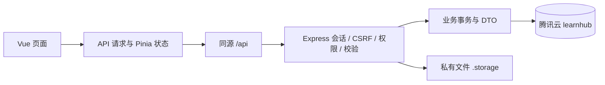

# 系统架构

## 技术选择

前端维持 Vue 3 + TypeScript + Pinia + Vue Router + Vite。后端采用 Node.js 24 + Express 5 + mysql2，Zod 校验，MySQL 8 InnoDB 持久化。

工程没有 ThinkPHP 控制器、Composer 依赖或 PHP 部署基础。Node 已有可用工具链，复用一套启动和测试流程更便于维护。PHP 可按需安装，缺少本机 PHP 并非不可引入后端的理由；本次基于现有代码的一致性选择 Node，没有拼接 Candy BBS 源码。

## 数据流

开发时 Vite 代理 /api 到 127.0.0.1:3001；生产时 Express 提供 dist 和 API。前端不包含数据库驱动或密码。bootstrap 返回现有 UI 所需 DTO，论坛列表额外采用 SQL 分页。

Pinia 只缓存接口结果。页面刷新重新查询，服务重启后从 MySQL 恢复会话和内容。localStorage 只保存主题和未发布编辑草稿，不再读取旧版业务缓存。

## 业务闭环

登录：验证 scrypt 哈希 → 随机会话 → 数据库只保存令牌 SHA-256 → HttpOnly、SameSite=Lax Cookie → 每次请求查询会话、状态和角色。

发帖：身份、字段和分类校验 → 事务插入 posts → 唯一事件奖励积分 → 返回 ID → 前端重新读取 → 进入详情。

评论：校验帖子和父评论归属 → 写入 post_comments → 通知作者 → 刷新。编辑删除检查作者或管理员。

资源：10 MB 内文件 → 类型签名/文本校验 → 随机私有键 → 待审 metadata → 管理员事务审核与奖励 → 受保护下载。头像与正文图片仅允许 2 MB 内 PNG/JPEG/WebP。

课程：唯一报名 → 验证章节归属 → 唯一完成记录 → 继续学习位置。章节 ID 稳定，重排不会直接丢失完成记录。

签到、采纳、审核使用事务和唯一积分事件，防止重复奖励；锁冲突有限重试，失败回滚。

## 权限与安全

- 注册不接受角色，管理员才能修改他人角色状态。
- 作者管理自己的帖子评论；教师编辑自己的课程；管理员管理内容。
- 停用、角色改变、改密撤销旧会话；前端角色只控制显示。
- 写接口校验 Origin 和当前会话 CSRF；令牌只留内存。
- 参数化 SQL、字段白名单、分页上限、上传限制、登录/API 限流和 Helmet。
- Markdown 经过 DOMPurify 清理；私有上传不暴露为静态文件目录。
- bootstrap 不返回密码哈希、会话令牌或他人私有通知、学习历史和 AI 草稿。
- 管理审计写入数据库；服务错误仅返回统一提示和 requestId。

## 当前容量边界

bootstrap 为保留现有 UI 的过渡读模型，最多加载 500 帖、200 课程、300 问题、500 资源。个人私有数据仅本人可读。论坛列表已独立 SQL 搜索分页；其他列表及全站搜索仍筛选从数据库加载的 DTO，后台也未完成全部分页。

扩大规模时应拆分详情/分页/搜索接口，并分页评论和用户。当前业务已真正落库，但不能把此读模型描述为大规模生产架构。
